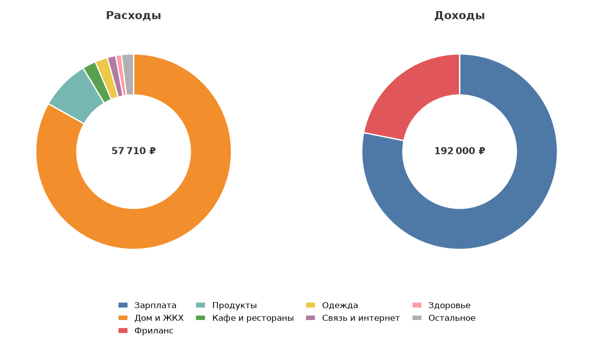
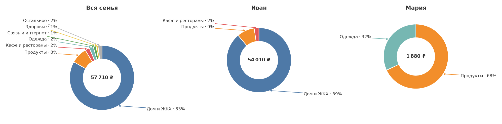

# 💸 Бот для учёта расходов и доходов

Телеграм-бот, который записывает траты и поступления по категориям и считает
отчёты за день, неделю, месяц, год и всё время. Данные хранятся локально
в SQLite, у каждого пользователя — свой набор категорий и своя история.

## Возможности

- **Расходы и доходы.** Две отдельные группы категорий, общий баланс за период.
- **Быстрый ввод.** Категория → сумма одним сообщением: `450`, `1 200,50`,
  `450 такси` (число станет суммой, остальное — комментарием).
- **Списком.** `обед 300 и ужин 300` — бот запишет две операции и покажет
  общую сумму 600.
- **Категории.** 12 готовых статей расходов (продукты, кафе, транспорт, жильё,
  здоровье, одежда, развлечения, связь, образование, путешествия, подарки,
  прочее) и 5 доходных. Можно добавлять свои, переименовывать и удалять.
- **Отчёты.** Итоги и разбивка по категориям с процентами и наглядными
  полосками, средний расход в день.
- **Диаграммы.** Цветные кольцевые схемы расходов и доходов: у каждой
  категории свой цвет, который повторяется во всех отчётах.
- **История.** Последние операции с постраничным просмотром и удалением.
- **Экспорт в CSV.** Файл открывается в Excel и Google Таблицах (UTF-8 BOM,
  разделитель `;`, запятая в десятичных).
- **Семья.** Приглашение по ссылке или коду, общий отчёт «кто сколько потратил»
  и история операций с автором.
- **Валюта.** Каждый выбирает своё обозначение (₽, $, €, ¥, ₸ и другие)
  в «⚙️ Настройках».
- **Приватность.** Без семьи каждый видит только свои данные; в семье общими
  становятся только отчёты участников.

## Диаграммы

В личном отчёте — две кольцевые схемы, в семейном — общая и по каждому участнику:





Цвет категории одинаковый на всех диаграммах, поэтому «Продукты» у всех
участников одного цвета. Подписи с процентами стоят вокруг диаграммы, от
каждой секции к своей подписи идёт стрелка, мелкие категории объединены
в «Остальное», в центре — сумма.

## Быстрый старт

1. Создайте бота у [@BotFather](https://t.me/BotFather) и скопируйте токен.
2. Установите зависимости:

   ```powershell
   python -m venv .venv
   .venv\Scripts\activate
   pip install -r requirements.txt
   ```

   Linux / macOS:

   ```bash
   python3 -m venv .venv
   source .venv/bin/activate
   pip install -r requirements.txt
   ```

3. Создайте `.env` из шаблона и впишите токен:

   ```powershell
   Copy-Item .env.example .env
   ```

4. Запустите:

   ```powershell
   python -m bot
   ```

   Или просто запустите `run.bat` (двойным щелчком либо `.\run.bat`) — он сам
   подставит зависимости из `.deps` и запустит бота.

Бот работает через long polling — ни домен, ни HTTPS не нужны.

## Как пользоваться

| Действие | Что делать |
|---|---|
| Записать трату | «➕ Расход» → категория → `450 такси` |
| Несколько трат сразу | `обед 300 и ужин 300` — две операции, всего 600 |
| Записать доход | «💰 Доход» → категория → `100000 зарплата` |
| Посмотреть отчёт | «📊 Отчёты» → Сегодня / Неделя / Месяц / Год / Всё время |
| Удалить операцию | «📜 История» → нажать на операцию → «🗑 Удалить» |
| Своя категория | «🗂 Категории» → Расходы/Доходы → «➕ Добавить» |
| Пригласить близкого | «👨‍👩‍👧 Семья» → «Создать семью» → отправить ссылку или код |
| Сменить валюту | «⚙️ Настройки» → выбрать валюту |
| Выгрузить всё | «📤 Экспорт» — придёт CSV-файл |

Сумму можно писать с пробелами, запятой или точкой, со значком валюты:
`1 200,50`, `1200.5`, `500 ₽`, `300р`. Отрицательные суммы бот не принимает —
для трат есть отдельный тип операции.

Несколько трат за раз разделяйте словом `и`, запятой с пробелом, `;`, `+`
или переносом строки: `обед 300 и ужин 300`, `300; 200`, `300, 200`.
Каждая часть станет отдельной операцией с комментарием, а в ответе будет
общая сумма. Записи можно отменить одной кнопкой «↩️ Отменить».

Команды: `/start` — меню, `/help` — справка, `/cancel` — отменить ввод.

## Семья

Раздел «👨‍👩‍👧 Семья» позволяет следить за деньгами вдвоём или всей семьёй.

- Создайте семью и отправьте близкому ссылку вида
  `https://t.me/ваш_бот?start=join_КОД` либо просто код из 8 символов.
- Участники видят общий отчёт: сколько потратил каждый, общие категории
  (одинаковые названия складываются) и историю операций с автором.
- В отчёте семьи у каждого участника показаны его собственные категории
  («кто на что потратил»), а рядом — общая диаграмма семьи и отдельная
  диаграмма каждого участника в тех же цветах.
- Свои записи и категории остаются личными. Чужие операции нельзя удалить или
  изменить, а после выхода человека его траты перестают попадать в общий отчёт.
- Владелец может исключать участников и менять код приглашения. Если владелец
  выходит, права переходят следующему участнику.
- Один человек может состоять только в одной семье.

## Настройки

Все настройки — в `.env`:

| Переменная | По умолчанию | Назначение |
|---|---|---|
| `BOT_TOKEN` | — | Токен от @BotFather, обязателен |
| `TIMEZONE` | `Europe/Moscow` | Часовой пояс, по которому определяется «сегодня» |
| `CURRENCY` | `₽` | Символ валюты в сообщениях |
| `DB_PATH` | `data/bot.db` | Путь к файлу базы |
| `LOG_LEVEL` | `INFO` | Уровень логирования |

`CURRENCY` — валюта по умолчанию для новых пользователей. Каждый может сменить
её в боте: «⚙️ Настройки» → валюта. Выбор хранится в профиле и применяется
в отчётах, истории, диаграммах и экспорте. Суммы при смене **не
пересчитываются** — меняется только обозначение.

## Чтобы бот работал постоянно

Токен хранится в `.env` и вводится один раз — при каждом запуске ничего
менять не нужно. Обычный `run.bat` работает, пока открыто его окно консоли.
Чтобы бот поднимался сам при входе в Windows и работал без окна:

1. Дважды щёлкните **`install_autostart.vbs`** — ярлык добавится в автозагрузку,
   и бот сразу запустится в фоне.
2. Ход работы пишется в `logs\bot.log`.
3. Остановить: **`stop_bot.bat`**.
4. Убрать из автозагрузки: **`uninstall_autostart.vbs`**.

| Файл | Что делает |
|---|---|
| `run.bat` | обычный запуск в окне консоли |
| `install_autostart.vbs` | автозапуск при входе + фоновый старт сейчас |
| `uninstall_autostart.vbs` | убрать из автозагрузки |
| `stop_bot.bat` | остановить фонового бота |
| `logs\bot.log` | лог работы |

Что важно знать:

- бот живёт, пока компьютер включён и вы вошли в Windows; при выключении или
  глубоком сне он остановится и поднимется после следующего входа;
- если бот упал, `run_silent.bat` перезапустит его через 30 секунд;
- второй экземпляр не запустится: бот занимает локальный порт и завершается
  с кодом 2 (это защита от конфликта `getUpdates`);
- `stop_bot.bat` завершает процессы `python.exe` / `python3.13.exe` на машине.
  Если параллельно работают другие Python-программы, остановите бота через
  Диспетчер задач;
- для круглосуточной работы лучше сервер или VPS — см. раздел Docker.

## Если что-то не запускается

**PowerShell: «выполнение сценариев отключено»** при `activate`.
Политика безопасности Windows запрещает `.ps1`-скрипты. Варианты:

```powershell
# разрешить скрипты только для текущего окна терминала
Set-ExecutionPolicy -Scope Process -ExecutionPolicy Bypass
.venv\Scripts\Activate.ps1
```

или вообще без активации:

```powershell
.venv\Scripts\python.exe -m pip install -r requirements.txt
.venv\Scripts\python.exe -m bot
```

или запустить `run.bat` — `.bat`-файлы политика не блокирует.

**`pip install -r requirements.txt` → «Could not open requirements file».**
Команда выполняется не из папки проекта. Перейдите в неё:

```powershell
cd "C:\Users\belon\Documents\deepseek-harness\default-workspace"
```

**`Defaulting to user installation because normal site-packages is not writeable`.**
Это не ошибка: у Python из Microsoft Store системная папка пакетов защищена,
и pip ставит пакеты в профиль пользователя. Внутри `.venv` сообщения не будет.

## Структура проекта

```
bot/
  __main__.py      запуск: python -m bot
  main.py          сборка Dispatcher, роутеров и polling
  config.py        чтение .env
  db.py            SQLite: схема и запросы
  models.py        Category, Transaction, Totals, Family
  currencies.py    список валют для настроек
  utils.py         разбор сумм, форматирование, периоды (чистые функции)
  charts.py        PNG-диаграммы расходов и доходов
  keyboards.py     инлайн-клавиатуры
  middlewares.py   создание пользователя и его настроек
  handlers/
    common.py      /start, /help, /cancel, меню
    transactions.py добавление и отмена операций
    history.py     история и удаление
    categories.py  управление категориями
    reports.py     отчёты за период
    family.py      семья: приглашения и общий отчёт
    settings.py    выбор валюты
    export.py      CSV
tests/
  test_utils.py    разбор сумм, форматирование, периоды
  test_db.py       база: категории, операции, итоги, миграция
  test_family.py   семья: участники, коды, общие итоги
  test_config.py   проверка .env
  test_handlers.py сквозной сценарий через настоящий Dispatcher
```

## Данные

- Всё лежит в одном файле SQLite (`data/bot.db` по умолчанию). Для бэкапа
  достаточно скопировать файл (и рядом лежащие `-wal`/`-shm`, если бот запущен).
- Суммы хранятся в копейках целыми числами — без ошибок округления float.
- Дата операции — локальная дата пользователя, поэтому отчёты не «съезжают»
  при смене часового пояса сервера.
- Категорию с операциями удалить нельзя: сначала удалите операции в истории.

## Запуск на сервере

### systemd

```ini
[Unit]
Description=Money bot
After=network.target

[Service]
WorkingDirectory=/opt/money-bot
ExecStart=/opt/money-bot/.venv/bin/python -m bot
Restart=always
RestartSec=5
User=moneybot

[Install]
WantedBy=multi-user.target
```

### Docker

```bash
cp .env.example .env   # впишите BOT_TOKEN
docker compose up -d --build
docker compose logs -f
```

База живёт в именованном томе `bot-data`, поэтому переживает пересборку.

## Тесты

```bash
pip install -r requirements-dev.txt
pytest
```

Тесты не обращаются к Telegram: сквозной сценарий использует поддельную
HTTP-сессию и проходит через настоящий `Dispatcher`.

### Если запускаете внутри песочницы DSH на Windows

Файловая песочница не даёт Python создавать временные каталоги с правами
`0o700`, поэтому `venv`/`pip` изнутри неё падают. Для этой машины зависимости
уже разложены в `.deps`, а `tools/devshim/sitecustomize.py` мягко обходит
особенность:

```powershell
$env:PYTHONPATH = "$PWD\.deps;$PWD\tools\devshim"
python -m pytest
python -m bot
```

В обычном терминале вне песочницы ничего этого не нужно.

## Что можно добавить дальше

- Месячные лимиты по категориям и предупреждения при превышении.
- Регулярные операции (аренда, подписки) с автоповтором.
- Графики за период.
- Общий бюджет на несколько человек (семья).
- Webhook-режим вместо polling при больших нагрузках.
